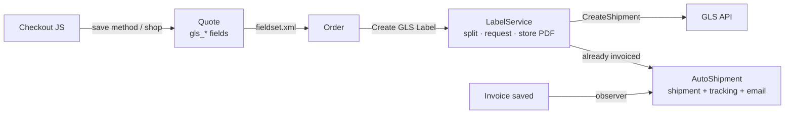

# Softcode_Gls – GLS Denmark for Magento 2

[](https://github.com/DritonCa/softcode-magento2-gls/actions/workflows/ci.yml)
[](https://packagist.org/packages/softcode/module-gls)
[](LICENSE)

GLS delivery for the Magento 2 checkout: Home, Business and ParcelShop delivery with a
parcel-shop picker, label creation from the admin order view, tracking links and
automatic shipment when the order is invoiced.

The module contains no shop-specific rules. What ships, and where the label is
addressed, are extension points you configure or replace from your own module.

## Features

- **Delivery methods** – GLS Home, Business and ParcelShop, each with its own price.
- **ParcelShop picker** – nearest shops from the GLS shop finder, saved on the quote
  and copied to the order (id, name and address).
- **Labels from the admin** – "Create GLS Label" on the order view calls the GLS
  CreateShipment API, stores the PDF and starts the download.
- **Heavy orders split into parcels** – one label per parcel under a configurable
  weight limit, plus a combined PDF (or a ZIP) for printing.
- **Tracking** – consignment ids become clickable links in Magento's shipment email
  and the customer's order history.
- **Ship when invoiced** – optional: invoicing an order with a label creates the
  shipment and sends the shipment email. Works in either order (label first or
  invoice first).
- **Non-shippable items** – virtual/downloadable products and SKUs you list never
  ship. A cart with nothing to ship gets a free "No delivery required" rate.
- **Secure by default** – form-key (CSRF) validation, server-side method/price
  validation, encrypted API password, ACL on label actions.

## Requirements

| | Supported |
|---|---|
| Magento Open Source / Adobe Commerce | 2.4.6 – 2.4.8 |
| PHP | 8.1 – 8.4 |
| GLS | A GLS Denmark customer account (for labels) |

Tested by installation, `setup:upgrade` and `setup:di:compile` on Magento 2.4.6-p3 with
PHP 8.2; 2.4.7 and 2.4.8 are covered by the Composer constraints but not yet
verified on a live shop.

## Installation

```bash
composer require softcode/module-gls:^2.0
bin/magento module:enable Softcode_Gls
bin/magento setup:upgrade
bin/magento setup:di:compile
bin/magento cache:flush
```

## Configuration

**Stores → Configuration → Sales → Shipping Methods → GLS**

| Setting | Notes |
|---|---|
| Enable GLS | Master switch for the delivery methods |
| Ship to Business / Home / Parcel Shop + price | Enable each method and set its price (0 = free) |
| Non-shippable SKUs | Comma- or line-separated SKUs that never ship |
| API User Name / Password / Customer ID / Contact ID | From GLS; needed for labels |
| Label API URL | Leave empty for `https://api.gls.dk/ws/DK/V1/CreateShipment` |
| Max Weight per Parcel (kg) | Default 15; 0 disables splitting |
| Ship When Invoiced | Create the shipment + send the shipment email on invoice |
| Tracking URL | `{number}` is replaced by the consignment id |

Grant the ACL resource **Create and Download GLS Labels** (`Softcode_Gls::gls_label`)
to the admin roles that print labels.

### Checkout integration

The checkout part renders into `window.softcode.delivery.mountPoint`
(`#sc-delivery-methods` by default) and reads the address from these fields:

| Field | Selector |
|---|---|
| Street / postcode | `#sc-address-street`, `#sc-address-postcode` |
| Alternative delivery address | `#sc-use-alt-address`, `#sc-alt-street`, `#sc-alt-postcode` |

It works out of the box with
[Softcode_CheckoutOverride](https://github.com/DritonCa/softcode-magento2-checkout-override)
and can be wired into any custom or headless checkout through the endpoints below.

| Endpoint | Method | Purpose |
|---|---|---|
| `/gls/index/methods` | GET | Enabled methods + `needs_shipping` for the cart |
| `/gls/index/getglslist` | GET | Parcel shops for `street` + `zipcode` |
| `/gls/index/save` | POST | Save `method`, `shop_id` (+ shop details) on the quote; needs `form_key` |
| `/gls/index/selected` | GET | The choice stored on the quote |

JavaScript events: `softcode:gls:rendered` (after the methods are drawn, e.g. to
reorder them) and `softcode:gls:saved`.

## Extending

**Exclude more items from shipping** – implement `Softcode\Gls\Api\ItemShippingRuleInterface`
and add it to the rule list in your module's `di.xml`:

```xml
<type name="Softcode\Gls\Model\Shippability">
    <arguments>
        <argument name="rules" xsi:type="array">
            <item name="courses" xsi:type="object">Vendor\Module\Model\CourseShippingRule</item>
        </argument>
    </arguments>
</type>
```

**Address labels differently** – the default `RecipientResolver` uses the order's
shipping address (company as the first line, "Att.: person" below). Replace it with a
preference for `Softcode\Gls\Api\RecipientResolverInterface`.

**Skip auto-shipment for one invoice** – set `gls_skip_auto_shipment` on the invoice
before it is saved.

## How it works



## Testing

The unit tests run without a Magento install (`Test/bootstrap.php` stubs the few
contracts they need):

```bash
phpunit -c phpunit.xml.dist
```

They cover the delivery-method rules and prices, shipping rules (product types,
excluded SKUs, child items, project rules), parcel splitting, phone formatting, the
GLS request XML (escaping, country codes, parcel shop) and response parsing. CI runs
them on PHP 8.1–8.4 together with the Magento 2 coding standard.

Label creation against the live GLS API needs GLS credentials and is verified
manually.

## Upgrading from 1.x

- New order columns for shop details, labels and tracking are added by `setup:upgrade`.
- The API password is now stored encrypted. Existing plain-text passwords keep
  working; re-save the field once to encrypt it.
- The GLS choice is now copied from quote to order by the module itself (`fieldset.xml`).

## Need help?

Installation, adaptation to your checkout or GLS setup:
[SoftCode](https://softcode.dk) – Magento 2 development in Copenhagen.

## License

MIT – see [LICENSE](LICENSE).
